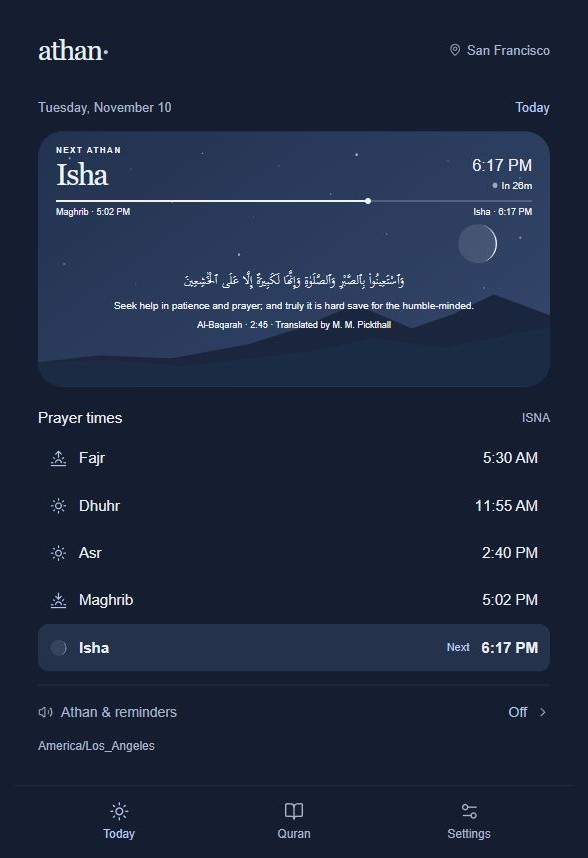
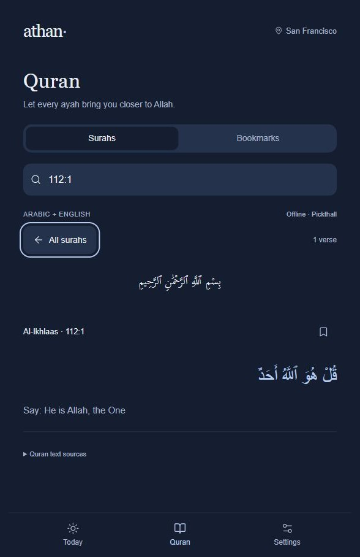
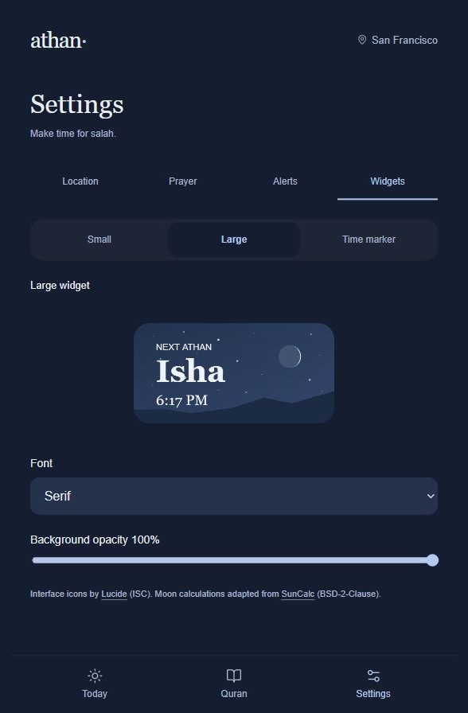

# Athan

A simple Android and iOS app for prayer times, athan reminders, and reading the Quran offline.

## Features

- ✅ Local prayer times and a countdown to the next athan
- ✅ Prayer reminders with athan audio or the phone's notification sound
- ✅ Five prayer themes, with moon phases in the Isha scene
- ✅ Customizable small, large, and time marker widgets
- ✅ Offline Arabic Quran and English translation, with search and bookmarks

## Screenshots

| Today | Quran | Widget settings |
| --- | --- | --- |
|  |  |  |

## Install

Clone the repository and run the setup commands below. Open `android/` in Android Studio and click **Run** with a phone or emulator selected. On macOS, run `npm run ios` and build in Xcode with your signing team and App Group configured for the app and widget.

After installing, choose a location and enable prayer reminders in **Settings → Alerts**. Add widgets from your phone's widget picker and customize them in **Settings → Widgets**.

## Development

Use Node.js 22.12+. Android builds also need Android Studio, SDK 36, and JDK 21. iOS builds need macOS and Xcode.

```sh
npm ci
npm run sync
npm run prepare:native
```

```sh
npm run dev    # Open the web preview
npm test       # Run tests
```

For a debug APK, run `./gradlew assembleDebug` inside `android/` (`gradlew.bat assembleDebug` on Windows). Find it at `android/app/build/outputs/apk/debug/app-debug.apk`.

## Credits

Arabic Quran text: [Tanzil Project](https://tanzil.net), with [source and license notices](public/QURAN-LICENSE.txt). English translation: Marmaduke Pickthall. See [attributions](public/ATTRIBUTION.txt) for the audio and other bundled sources.
